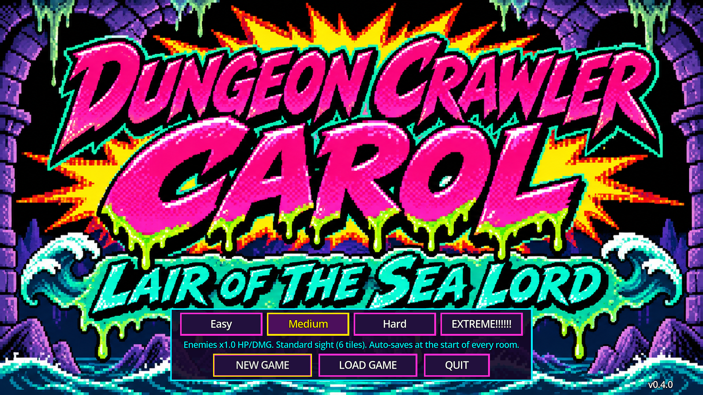
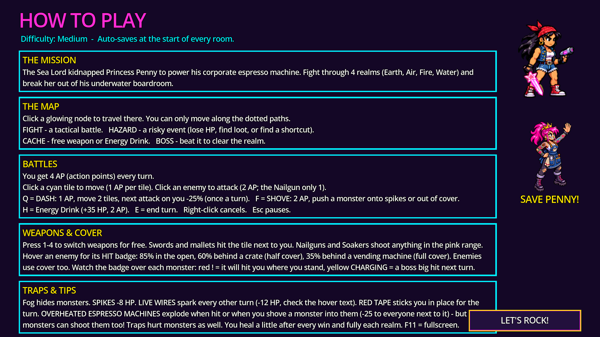
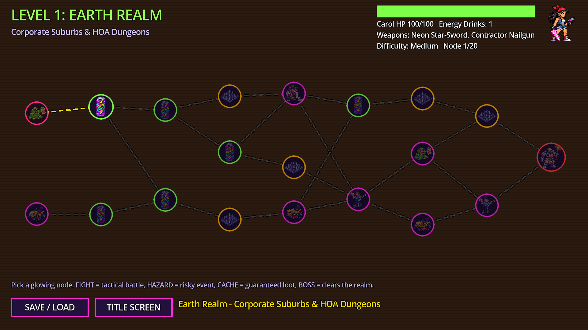
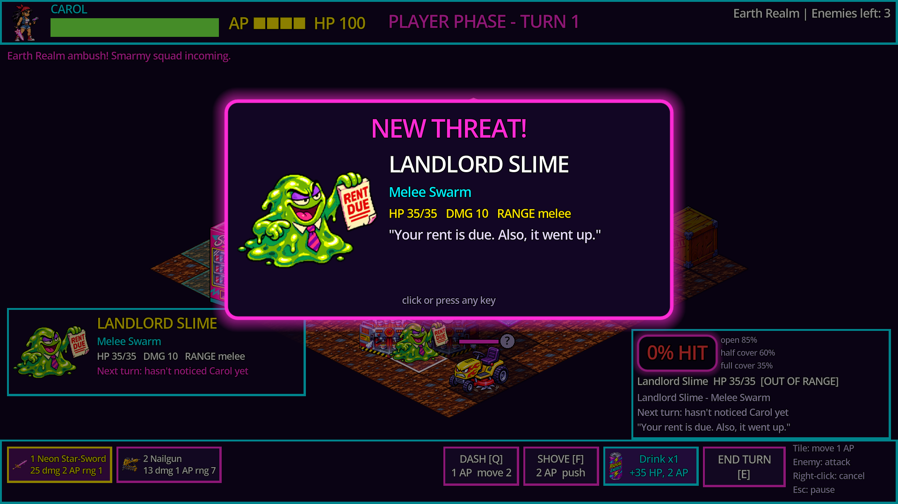
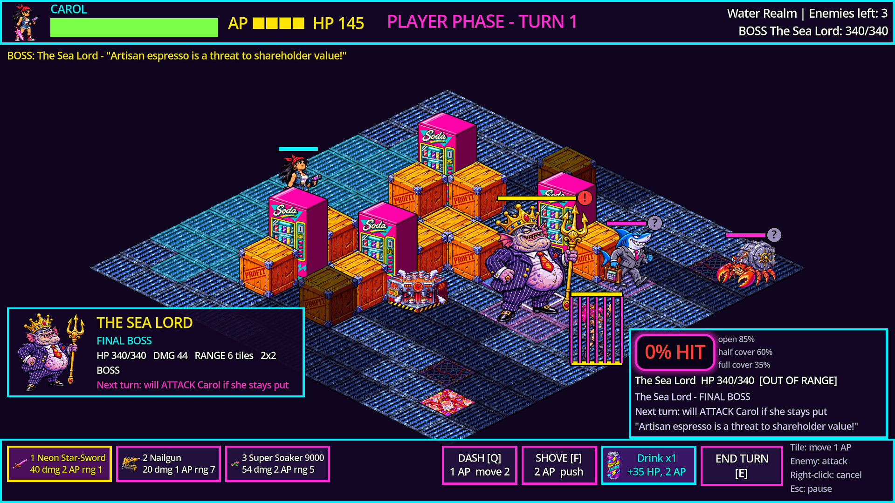

# Dungeon Crawler Carol: Lair of The Sea Lord — v0.5.0

A 1990s-cartoon 2.5D isometric turn-based tactical RPG made in **Godot 4.7** (GDScript).
Carol fights through four elemental realms of corporate monsters to rescue her girlfriend,
Princess Penny, from the Sea Lord's underwater boardroom.

V2 is the **HD tactical overhaul**: 1920x1080 fullscreen, high-res sprites, a 128x64 isometric
grid and XCOM-style cover.

**v0.3.0 "Telegraphs & Tunes"** adds:
- smarter cover-using enemies with telegraphed intents
- boss charge attacks with red danger zones
- Carol's Dash and Shove
- a rapid-fire Nailgun
- procedural Carol animations
- original chiptune music and sound
- a pause menu with volume settings
- safer saves
- a re-tuned difficulty curve

**v0.5.0 "New Art"** adds frame-by-frame Carol animation and new grid-aligned art for the props
and traps, imported with `scripts/tools/import_art.gd`.

**v0.4.0 "Traps & Drama"** added:
- live wires, red tape and exploding espresso machines
- NEW THREAT! / BOSS FIGHT! intro cards
- an enemy hover card with portrait and stats
- an art brief for the next round of art (`docs/art_brief.md`)

See [CHANGELOG.md](CHANGELOG.md).





| Node map | Tactical battle | Final boss |
|---|---|---|
|  |  |  |

## Play it

* **Windows:** download the zip from this repository's **Releases** page (tag `v0.5.0`), unzip it and run
  `DungeonCrawlerCarol_V2.exe`. It starts fullscreen; press **F11** to switch between fullscreen and a window.
  Build zips are no longer committed to the repo (the old `releases/` zip is still in the git history for v0.2).
* **From source:** open this folder in Godot 4.7 and press F5.

### Controls

| Input | Action |
|---|---|
| Left-click a cyan tile | Move (1 AP per tile) |
| Left-click an enemy | Attack with the equipped weapon (2 AP) |
| `1`-`4` or weapon buttons | Switch weapon (free) |
| `Q` or Dash button | DASH: 1 AP, move up to 2 tiles, next attack on Carol -25% (once a turn) |
| `F` or Shove button | SHOVE: 2 AP, push an adjacent monster onto spikes or out of cover |
| `H` or Drink button | RADICAL Energy Drink: +35 HP for 2 AP |
| `E` / Space / Enter or End Turn | End your turn |
| Right-click | Cancel Dash / Shove |
| `Esc` | Pause menu: volume, screen shake, fullscreen, quit to title |
| `F11` | Toggle fullscreen / windowed |

Hover an enemy to see the neon hit badge (`85% HIT`, `60% HIT`, `35% HIT`), its cover, HP, what it plans to do next
turn, and its flavor text. Hover a move tile to see how many monsters could hit you there.

Click an **Overheated Espresso Machine** (the red box with the hazard stripes) to blow it up. Everyone on the 8 tiles
around it gets hit. **Live wires** spark on every other turn, and **red tape** sticks you in place for the rest of the turn.

Every monster shows its **intent** next to its HP bar:
- red **!** means it will hit Carol where she stands
- cyan **>** means it's moving
- grey **?** means it hasn't noticed her
- yellow **CHARGING!** means a boss strike is coming: get out of the red danger zone

## What's in the game

* **Flow:** `TitleScreen` (4 difficulties, 3 save slots) -> How to Play -> `NodeMap` -> `TacticalBattlefield` -> Victory / Game Over.
* **HD display:** 1920x1080 viewport, fullscreen on boot, `canvas_items` stretch with `keep` aspect, linear filtering.
  Menus and HUDs are laid out on a 1280x720 design grid and scaled x1.5, with MSDF fonts so text stays sharp.
* **Sprites:** high-res transparent PNGs built from the full-size art. `SpriteScaler.gd` scales every sprite to its
  footprint: 128x128 for Carol, Penny and regular enemies, 256x256 for 2x2-tile bosses, 128x128 / 128x192 for
  crates / vending machines, and 56x56 for projectiles and drops. Missing PNGs get procedural placeholders.
* **Node map:** a Slay the Spire-style branching graph per realm (15-20 nodes): Combat, Hazard, Supply Cache
  (weapon or drink) and Boss. The boss is always in the final 25% of nodes, and every path leads to it.
* **Tactical battles:** 10x10 to 12x12 rooms (bosses 12x12) on a 128x64 isometric `TileMapLayer`, under a fixed
  Camera2D. `AStarGrid2D` pathfinding, reachable tiles in neon cyan, weapon range in neon pink, y-sorted units,
  props and projectiles. Turns go Player Phase, then Enemy AI Phase.
* **4 AP turns:** move 1 AP per tile, attack 2 AP (Nailgun 1 AP), Dash 1 AP, Shove 2 AP, Energy Drink 2 AP.
* **Enemy AI** (`EnemyAI.gd`): ranged monsters pick covered, flanking firing spots, and melee monsters close in.
  Bosses charge for a turn, lock onto a red danger zone, then strike for ×1.3. Bosses move as a 2×2 block.
* **Cover:** 85% to hit in the open, 60% behind half cover (crates), 35% behind full cover (vending machines).
  Cover counts when it's on a tile next to the target, facing the shooter, so flanking works. A vending machine in
  the middle of the line blocks the shot (`RayCast2D`). Melee ignores cover. Enemies use the same rules on Carol.
* **Bosses** take up 2x2 tiles: HOA President Golem, Smug Vape Cloud, Burnout CEO Fire Demon and The Sea Lord.
* **Fog of war:** your sight radius depends on difficulty. Enemies stay hidden until you can see them, and
  an enemy that attacks from the dark is revealed.
* **Projectiles:** 15 `ProjectileData` resources with tweened motion (straight, lobbed arc, spinning, wobbling,
  beam) and afterimage trails: star slashes, water jets, steel nails, eviction notices, crypto coins, spam pop-ups,
  vape rings, the CEO trident beam and more.
* **Roster:** all 24 monsters (5 per realm + 1 boss) and 4 weapons. Carol starts with the Neon Star-Sword and
  Contractor Nailgun, can find the Squeaky Foam Mallet, and gets the Super Soaker 9000 before the Fire level.
* **Difficulty:** Easy 0.8x / Medium 1.0x / Hard 1.3x / EXTREME 1.6x enemy HP and damage. Easy and Medium
  auto-save at the start of every room, Hard only at level start, and EXTREME is permadeath (the run save is
  deleted and you restart at Level 1).
* **Rescue ending:** beating the Sea Lord breaks Penny's cage and plays the victory screen.
* **Saves** are JSON in `user://savegame.json` (slot 1) and `savegame_2/3.json`. They're written atomically
  (`.tmp`, then swapped, with a `.bak` fallback) and validated on load. On EXTREME, quitting mid-fight counts as a death.
* **Audio:** 23 effects and 8 music tracks, all synthesized by `tools/synth_audio.py` (run it to regenerate).
* **Animation:** Carol has a procedural animation set (idle, walk hop, dash, attack, shove, hurt, dodge, drink, death,
  victory) built from her single sprite in `CarolUnit.gd`.

## Project layout

```
assets/sprites/        HD sprites (+ generated 128x64 iso floor tiles)
assets/audio/          synthesized sound effects and music (WAV)
scenes/overworld/      NodeMap, NodeButton, OverworldGenerator
scenes/tactical/       TacticalBattlefield, EnemyAI, IsometricGrid, GridOverlay, Projectile, CombatMath
scenes/units/          CarolUnit, EnemyUnit, PrincessPenny (BattleUnit base)
scenes/items/          TacticalDrop
scenes/ui/             TitleScreen, HowToPlay, TacticalHUD, SaveMenu, VictoryScreen
scripts/autoload/      GameState (F11, difficulty, auto-save, version), SignalBus, SaveManager, AudioManager, PauseMenu
scripts/resources/     WeaponData, EnemyData, ProjectileData (custom Resources)
scripts/util/          SpriteScaler (footprint scaling + placeholder textures)
scripts/data/          Roster.gd - the stat tables everything is generated from
scripts/tests/         run_unit_tests.gd (headless)
scripts/tools/         HD asset pipeline, .tres generator, screenshot tool, autoplay_sim, audit_probe
tools/                 synth_audio.py (pure-Python chiptune synthesizer)
resources/             4 weapons, 24 enemies, 15 projectiles (.tres)
docs/                  design document, art manifest, screenshots
```

## Build and test

```bash
godot --headless --import
godot --headless --quit
godot --headless --script res://scripts/tests/run_unit_tests.gd
godot --headless --export-release "Windows Desktop" builds/DungeonCrawlerCarol_V2.exe
```

The test runner checks the HD display settings and sprite scaling, boots into the title screen, starts a new
game, generates 100 node maps, plays a mock tactical turn (move, cover hit chances, attack, drink, enemy phase,
victory), fights all 4 bosses including the Penny rescue, and checks save/load, auto-saves and the permadeath wipe.
There are 209 checks (pathing, line of sight, fog, Dash/Shove, enemy AI cover choice, boss telegraphs, audio,
pause menu, atomic saves, permadeath), and the process exits with the number of failures.

Balance regression: `godot --headless --script res://scripts/tools/autoplay_sim.gd -- 30` plays 30 battles per
scenario with a bot and prints win rate, turns and HP lost.

To rebuild the HD sprites from the full-size art:
`godot --headless --script res://scripts/tools/build_assets.gd -- <folder with master PNGs>`.
To change monster, weapon or projectile stats, edit `scripts/data/Roster.gd` and run
`godot --headless --script res://scripts/tools/generate_resources.gd`.

## Notes and deviations from the spec

* Fast monsters (the mower, bats, imps and bug) move 2 tiles per AP. Armored tanks ignore part of incoming damage.
* Each monster attacks at most once per turn so that 4 AP enemy squads stay survivable.
* Carol deals +20% damage per realm cleared. She heals 15 HP after each fight and fully between realms.
* Crates are half cover and block movement only. Vending machines are full cover and also block line of sight.
  The rooms have no walls or trash cans, so those cover types aren't placed. Spike traps deal 8 damage.
* The `ui_hit_chance_badge` art has "85%" baked in, so the HUD draws its own neon badge with the live number.
* Menus are laid out at 1280x720 and scaled x1.5 rather than re-laid out at 1920x1080.
* Scene names follow the V2 spec: `OverworldMap` is now `NodeMap`, `TacticalBattle` is now
  `TacticalBattlefield`, and the `SaveSystem` autoload is now `SaveManager`.
